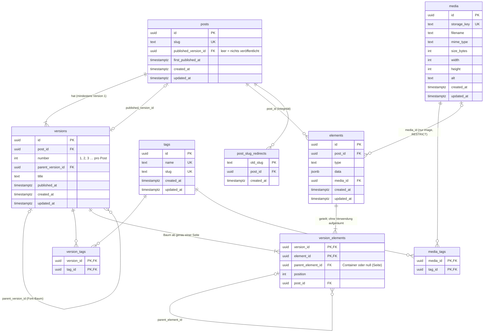

# rootyourself – Konzept

Blog mit öffentlichem Frontend und passwortgeschütztem Admin-Bereich in einer
Next.js-App. Es gibt genau eine Person, die Posts schreibt.

## Stack

| Bereich            | Wahl                                                                  |
| ------------------ | --------------------------------------------------------------------- |
| App                | Next.js (App Router), React, TypeScript, Tailwind                     |
| Hosting            | Vercel, Region Frankfurt (`fra1`, `vercel.json`); kein lokales Dateisystem |
| Datenbank          | Neon Postgres 18 (Free-Plan, Frankfurt), via Vercel Marketplace       |
| Datenbank-Zugriff  | Drizzle ORM; Neon-WebSocket-Treiber (Produktion), `pg` (lokal)        |
| Bilder             | Cloudflare R2 (Produktion), RustFS (lokal, S3-kompatibel); Upload per Presigned URL direkt aus dem Browser |
| Backend-Schnittstelle | REST-API über Route Handlers (`src/app/api/…`)                     |
| Zugangsschutz      | Login mit E-Mail und Passwort (bcrypt) gegen die Tabelle `users`, Session-Cookie, geprüft in `proxy.ts` |
| Tests              | Vitest gegen eine Testdatenbank im lokalen Postgres-Container         |
| Suche              | Später: Algolia, befüllt beim Veröffentlichen                         |
| Lokale Entwicklung | Docker (`docker/docker-compose.dev.yml`): App auf Port 3002, Postgres 18 auf Port 5433, RustFS auf Port 9010 (Weboberfläche 9011) |

## Lokale Entwicklung

- `npm run docker:dev` startet App und Postgres-Container (gleiche Version wie Neon, Postgres 18).
  Die Daten liegen im Docker-Volume `rootyourself_pgdata`.
- `src/db/index.ts` wählt den Treiber anhand von `DATABASE_URL`: Neon-Host → Neon-WebSocket-Treiber,
  sonst `pg` (node-postgres).
- `.env.local` zeigt auf `localhost:5433`, damit `drizzle-kit` (`npm run db:migrate`, `npm run db:studio`)
  vom Host aus funktioniert. Im Web-Container überschreibt die Compose-Datei den Wert mit `db:5432`.
- Die Produktions-Datenbank steht bewusst nicht in `.env.local`. Migrationen für Neon:
  `npm run db:migrate:prod` holt die Zugangsdaten mit `vercel env pull` in ein temporäres
  Verzeichnis (danach gelöscht), zeigt die fehlenden Migrationen und spielt sie nach
  Rückfrage über die direkte Verbindung ein. `-- --check` zeigt nur den Stand,
  `-- --yes` spielt ohne Rückfrage ein (nötig ohne Terminal, z. B. mit `!` in Claude Code).
  Preview und Produktion nutzen dieselbe Neon-Datenbank: Migrationen vor dem Merge nach
  `production` einspielen und nur solche, die der laufende Code verträgt (neue Tabellen
  und Spalten ja, Umbenennen oder Löschen nicht).
- Vercel deployt den Zweig `production` in die Produktion; `main` ergibt ein Preview.
- Tests: `npm test` (Vitest, eigene Testdatenbank `rootyourself_test`) und
  `npm run test:e2e` (Playwright, `e2e/`) gegen die laufende Docker-App auf Port 3002
  (`E2E_BASE_URL` überschreibt). Die Browser-Tests nutzen das installierte Google Chrome.
  Das Setup legt in der Entwicklungsdatenbank den Nutzer `e2e-test@example.com` an und
  meldet ihn an, das Teardown löscht ihn wieder; Ordner und Posts heißen „E2E …“ und
  werden nach jedem Test entfernt, auch wenn er fehlschlägt. Läuft App oder
  `DATABASE_URL` nicht auf localhost, brechen die Tests ab (Neon ist geteilt).
- RustFS ersetzt lokal Cloudflare R2 (MinIO wird nicht mehr als Image veröffentlicht). Der Code
  spricht nur die S3-API; umgeschaltet wird über die `S3_…`-Variablen. `storage-setup` legt beim
  Start den Bucket an und setzt öffentliches Lesen und CORS (`scripts/setup-storage.mjs`).
- Neue npm-Pakete brauchen einen Neubau des Web-Containers (`npm run docker:dev:build`), weil
  dessen `node_modules` in einem eigenen Volume liegen.

## Entitäten

- **Post**: Klammer um einen Slug. Hat einen Baum von Versionen, von denen
  höchstens eine veröffentlicht ist.
- **Version**: ein vollständiger Stand eines Posts – Titel, Tags und der Inhalt
  als Baum von Elementen mit genau einer **Seite** (`page`) als Wurzel. Entsteht
  beim Anlegen des Posts (Version 1, mit leerer Seite) oder durch Forken einer
  bestehenden Version.
- **Element**: Inhaltsbaustein. Typen: `heading`, `text` (Markdown), `image`
  (verweist auf die Mediathek) und die Container `list`, `slide` und `page`;
  weitere folgen. Mehrere Versionen desselben Posts können dasselbe Element
  verwenden (Copy-on-Write).
  Jeder Typ ist in `src/elements/<typ>/schema.ts` **definiert**: ein Name und
  ein Objekt mit einem Eintrag pro **Attribut**. Der Eintrag bestimmt vollständig
  die Darstellung im Formular, die erlaubten Werte (Zod; damit prüfen Server und
  Popup) und den Default. Attribut-Arten (`src/elements/attributes.ts`):
  - `line` – einzeilige Eingabe, getrimmt; `required` (Meldung „<Label> darf
    nicht leer sein“) oder optional (leer: nicht gesetzt); `max`.
  - `markdown` – Textarea; `max`.
  - `select` – Auswahl aus festen Werten (`options`), `default`.
  - `mediaRef` – Bild aus der Mediathek, Pflicht. Steht nicht in `data`, sondern
    in `elements.media_id` (verwendete Bilder lassen sich nicht löschen);
    höchstens eins pro Element.
  Die gespeicherte Form ist `{ type, data, mediaId? }`; `data` enthält alle
  Attribute außer `mediaRef`. Beispiel Überschrift: `level` (select H2/H3,
  Default 2), `text` (line, Pflicht, höchstens 300 Zeichen).
  Ein Element ist in einem von drei **Modi**:
  - **Show** – wie die Website es zeigt (auch die Vorschau im Editor);
    `<typ>/show.tsx`.
  - **View** – wie der Editor es zeigt, wenn man eine Version bearbeitet;
    `<typ>/view.tsx`; wie Show, nur Bilder als Vorschau (höchstens 300 × 300 px,
    nie breiter als ihr Platz). Der Editor legt einen Rahmen mit „Bearbeiten“
    drumherum; Container geben ihre Kinder über `renderChild` aus, damit auch
    jedes Kind seinen Rahmen bekommt.
  - **Edit** – das Formular, für alle Typen aus den Attributen gebaut
    (`src/elements/form.tsx`): ein Formular-Element pro Attribut, untereinander,
    mit Label. Erscheint erst nach „Bearbeiten“, im Popup (siehe „Editor“).
  **Container-Elemente** (`container: true` in der Definition) enthalten beliebig
  viele Elemente beliebigen Typs (außer der Seite), auch weitere Container,
  beliebig tief – sinnvoll zu verschachteln liegt bei der Autorin. Die Kinder
  sind eigene Elemente (Copy-on-Write, Bildschutz wie überall) und hängen über
  `version_elements.parent_element_id` am Container; ihre Position zählt
  innerhalb des Containers. Schutz gegen riesige Bäume (auch über die API):
  höchstens 300 Elemente pro Seite, die Seite und Verschachteltes mitgezählt
  (`MAX_PAGE_ELEMENTS`). Leere Container sind erlaubt.
  - **Seite** (`page`, `root: true`): die Wurzel jeder Version, eine erweiterte
    Liste mit denselben Attributen. Wird nirgends hinzugefügt und lässt sich
    weder verschieben noch ausschneiden noch löschen.
  - **Liste** (`list`): Attribut `orientation` (Ausrichtung, Default
    untereinander). `vertical`: Kinder untereinander, jedes in seiner Höhe, so
    breit wie das Elternteil. `horizontal`: n Kinder je 1/n der Breite (mit
    festem Abstand dazwischen), die Reihe so hoch wie das höchste Kind; auf
    schmalen Bildschirmen (unter 768 px) untereinander. Ohne
    Aufzählungszeichen. View wie Show (`src/elements/list/stack.tsx`).
  - **Slide** (`slide`): Container ohne eigene Attribute. Im Frontend stehen die
    Kinder nebeneinander, je 300 × 300 px (Bilder schrumpfen, damit eine
    Unterschrift Platz hat; zu viel Inhalt wird abgeschnitten). Passen sie nicht in
    die Breite, erscheinen Pfeile links und rechts; auf dem Handy auch wischen.
    Auch als Kind einer horizontalen Liste bekommt sie strikt ihren Anteil und
    blättert darin. View wie Show.
  `src/elements/schema.ts` sammelt die Definitionen; daraus leiten sich die Typen
  für API, Server und Editor ab. Ein neuer Typ braucht einen Ordner (`schema.ts`,
  `show.tsx`, `view.tsx`) und je einen Eintrag in `src/elements/schema.ts` und
  `src/elements/components.tsx` (Show und View; ohne `"use client"`, damit Show
  auch auf dem Server rendert). Bekommt ein weiterer Typ ein `mediaRef`, muss der
  Check `elements_media_check` (fest auf `image`) per Migration angepasst werden.
- **Tag**: Name und Slug. Gemeinsam für Posts und Medien: an Posts als
  Metadaten pro Version, an Medien zum Ordnen der Mediathek (nicht versioniert).
- **Medium**: Bild in R2, verwaltet über die Mediathek. Liegt in genau einem Ordner.
- **Ordner**: ordnet die Mediathek, beliebig verschachtelt; Namen je Elternordner
  eindeutig. Nicht versioniert.

## Seitenlayout

```
Header   – für alle Seiten gleich, im Code (vorerst ohne Navigation)
Main     – der Inhalt der Version: ein Baum ab der Seite
 Seite (untereinander)
 ├─ Liste (nebeneinander)            ┌──────┬──────┬──────┐
 │   ├─ Liste: Überschrift, Text     │  1/3 │  1/3 │  1/3 │
 │   ├─ Bild                         └──────┴──────┴──────┘
 │   └─ Slide: Bild, Bild, Text …
 └─ Text
Footer   – für alle Seiten gleich, im Code
```

- Layout entsteht nur aus verschachtelten Listen (und der Seite) mit ihrer
  Ausrichtung; was früher eine Row mit drei Zellen war, ist eine horizontale
  Liste mit drei Listen darin. Zellen über mehrere Spalten oder Zeilen gibt es
  (vorerst) nicht.
- Lesereihenfolge (Anreißer, Teaser-Bild, später Suche): der Baum ab der
  Seite, Tiefe zuerst, Kinder nach `position`. Anreißer und Teaser-Bild
  überspringen Slides.

## Versionierung

### Begriffe

- **Fork-Baum**: Jede Version außer Version 1 hat eine Elternversion
  (`parent_version_id`), von der sie geforkt wurde.
- **Blatt**: Version ohne Kinder.
- **Eingefroren**: nicht veränderbar. Eingefroren sind alle inneren Knoten
  (Versionen mit Kindern) und die veröffentlichte Version.
- **Bearbeitbar** sind also genau die unveröffentlichten Blätter.

### Regeln

| Aktion | Verhalten |
| --- | --- |
| Post anlegen | In einer Transaktion: Post, Version 1 und ihre leere Seite (ohne Tags). |
| Version forken | Von jeder Version möglich (auch eingefroren). Neue Version mit nächster `number`, `parent_version_id` = Quelle, gleicher Titel. Kopiert werden `version_elements` und `version_tags` (kleine Strukturdaten) – keine Elementinhalte. |
| Unveröffentlichtes Blatt speichern | Direkt in dieser Version, mit Überschreib-Schutz über `versions.updated_at`. |
| Veröffentlichtes Blatt speichern | Die veröffentlichte Version bleibt unverändert. Es entsteht automatisch ein unveröffentlichter Fork, in dem die Änderungen gespeichert werden. Die Antwort enthält die neue Versions-ID; der Editor wechselt dorthin. |
| Eingefrorenen inneren Knoten speichern | Abgelehnt (`409 version_frozen`). Zum Weiterarbeiten aktiv forken. |
| Element ändern | Nutzt nur diese eine Version das Element, wird es direkt geändert. Nutzen es mehrere Versionen, entsteht ein Klon mit neuer ID, auf den nur diese Version umgehängt wird. |
| Element hinzufügen | Neues Element. |
| Element entfernen / umsortieren / in einen anderen Container verschieben | Nur `version_elements` ändert sich; keine neuen Element-IDs. |
| Ausrichtung einer Liste ändern | Ändert das Listen-Element (Copy-on-Write wie jedes Element). |
| Tags ändern | Nur `version_tags` dieser Version. Kein Teilen, kein Copy-on-Write. |
| Aufräumen | Elemente, die keine Version mehr nutzt, werden in derselben Transaktion gelöscht. |
| Version veröffentlichen | Jede Version (auch ein innerer Knoten = Rollback). `posts.published_version_id` zeigt auf sie, `versions.published_at = now()`, beim ersten Mal auch `posts.first_published_at = now()`. Ändert `posts.updated_at` (der Slug-Überschreib-Schutz sieht die Veröffentlichung). |
| Veröffentlichung zurückziehen | `posts.published_version_id = NULL`. |
| Version löschen | Nur unveröffentlichte Blätter, und nicht die letzte verbleibende Version eines Posts (`409 version_published` / `version_has_children` / `last_version`). |

- Innerhalb einer Version kommt jedes Element höchstens einmal vor.
- Jede Änderung an Versionen (Speichern, Forken, Veröffentlichen, Löschen)
  sperrt den Post (`SELECT … FOR UPDATE`). Änderungen an einem Post laufen
  dadurch nacheinander: „ist ein Blatt“ kann zwischen Prüfung und Schreiben
  nicht durch ein paralleles Forken ungültig werden, und die nächste
  Versionsnummer ist eindeutig.
- Wird der einzige Fork einer Version gelöscht, ist sie wieder ein Blatt und
  damit – sofern nicht veröffentlicht – wieder bearbeitbar.

### Speichern eines Blatts im Detail

Der Editor schickt den vollständigen Stand der Version:

```json
{
  "title": "…",
  "tagIds": ["…"],
  "root": {
    "id": "…", "type": "page", "data": { "orientation": "vertical" },
    "children": [
      { "id": "…", "type": "text", "data": { "markdown": "…" } },
      {
        "type": "list", "data": { "orientation": "horizontal" },
        "children": [
          { "type": "image", "data": { "caption": "…" }, "mediaId": "…" }
        ]
      }
    ]
  },
  "updatedAt": "…"
}
```

Die Reihenfolge der `children` ergibt die `position`. Die Wurzel muss eine
Seite sein, darunter gibt es keine.

In einer Transaktion:

1. Version sperren; prüfen: Blatt, nicht veröffentlicht (sonst Auto-Fork),
   `updatedAt` passt (sonst `409 version_conflict`).
2. Titel übernehmen, `version_tags` ersetzen.
3. Für jedes Element:
   - ohne `id` → neues Element anlegen;
   - mit `id` → muss bereits in dieser Version verlinkt sein (sonst `400`);
     unverändert → behalten; verändert → direkt ändern, wenn nur diese
     Version es nutzt, sonst klonen.
4. `version_elements` der Version neu schreiben (Strukturdaten ohne Inhalt;
   Neuschreiben ist einfacher als ein Abgleich).
5. Verwaiste Elemente des Posts löschen, `versions.updated_at = now()`.

- Ungültige Eingaben (fremde Element-IDs) werden geprüft, bevor ein Auto-Fork
  entsteht – es bleibt also kein leerer Fork übrig. Unbekannte Tags oder
  Bilder brechen die ganze Transaktion ab.
- Grenzen: höchstens 300 Elemente pro Seite (Seite und Verschachteltes
  mitgezählt), Markdown höchstens 50 000 Zeichen pro Text-Element.
- „Unverändert“ vergleicht Typ, Medium und `data` inhaltlich (unabhängig von
  der Reihenfolge der JSON-Schlüssel).

## Datenbankschema

### Diagramm



Lesehilfe: `||` genau eins, `|o` null oder eins, `|{` eins oder mehrere,
`o{` null oder mehrere.

- **Pro Version kopiert** beim Forken: `version_elements`, `version_tags`.
- **Zwischen Versionen geteilt** (Copy-on-Write): `elements`.
- **Global**: `tags`, `media`, `media_tags`.

### SQL

```sql
CREATE TABLE tags (
  id          uuid PRIMARY KEY DEFAULT gen_random_uuid(),
  name        text NOT NULL UNIQUE,
  slug        text NOT NULL UNIQUE,
  created_at  timestamptz NOT NULL DEFAULT now(),
  updated_at  timestamptz NOT NULL DEFAULT now()
);

CREATE TABLE media (
  id          uuid PRIMARY KEY DEFAULT gen_random_uuid(),
  storage_key text NOT NULL UNIQUE,
  filename    text NOT NULL,
  mime_type   text NOT NULL,
  size_bytes  integer NOT NULL,
  width       integer NOT NULL,
  height      integer NOT NULL,
  alt         text NOT NULL DEFAULT '',
  created_at  timestamptz NOT NULL DEFAULT now(),
  updated_at  timestamptz NOT NULL DEFAULT now()
);

-- Tags an Medien (nicht versioniert).
CREATE TABLE media_tags (
  media_id  uuid NOT NULL REFERENCES media (id) ON DELETE CASCADE,
  tag_id    uuid NOT NULL REFERENCES tags (id)  ON DELETE CASCADE,
  PRIMARY KEY (media_id, tag_id)
);
CREATE INDEX media_tags_tag_idx ON media_tags (tag_id);

CREATE TABLE posts (
  id                    uuid PRIMARY KEY DEFAULT gen_random_uuid(),
  slug                  text NOT NULL UNIQUE,
  published_version_id  uuid,
  first_published_at    timestamptz,
  created_at            timestamptz NOT NULL DEFAULT now(),
  updated_at            timestamptz NOT NULL DEFAULT now(),
  CHECK (published_version_id IS NULL OR first_published_at IS NOT NULL),
  -- Die veröffentlichte Version muss zu diesem Post gehören.
  FOREIGN KEY (id, published_version_id) REFERENCES versions (post_id, id)
);
CREATE INDEX posts_feed_idx ON posts (first_published_at DESC, id DESC)
  WHERE published_version_id IS NOT NULL;

CREATE TABLE versions (
  id                 uuid PRIMARY KEY DEFAULT gen_random_uuid(),
  post_id            uuid NOT NULL REFERENCES posts (id) ON DELETE CASCADE,
  number             integer NOT NULL,          -- 1, 2, 3 … pro Post
  parent_version_id  uuid,
  title              text NOT NULL,
  published_at       timestamptz,               -- letzte Veröffentlichung dieser Version
  created_at         timestamptz NOT NULL DEFAULT now(),
  updated_at         timestamptz NOT NULL DEFAULT now(),
  UNIQUE (post_id, number),
  UNIQUE (post_id, id),
  CHECK (parent_version_id <> id),
  -- Die Elternversion muss zum selben Post gehören.
  FOREIGN KEY (post_id, parent_version_id) REFERENCES versions (post_id, id)
);
CREATE INDEX versions_parent_idx ON versions (parent_version_id);

CREATE TABLE version_tags (
  version_id  uuid NOT NULL REFERENCES versions (id) ON DELETE CASCADE,
  tag_id      uuid NOT NULL REFERENCES tags (id)     ON DELETE CASCADE,
  PRIMARY KEY (version_id, tag_id)
);
CREATE INDEX version_tags_tag_idx ON version_tags (tag_id);

CREATE TABLE elements (
  id          uuid PRIMARY KEY DEFAULT gen_random_uuid(),
  post_id     uuid NOT NULL REFERENCES posts (id) ON DELETE CASCADE,
  type        text NOT NULL,
  data        jsonb NOT NULL DEFAULT '{}',
  media_id    uuid REFERENCES media (id) ON DELETE RESTRICT,
  created_at  timestamptz NOT NULL DEFAULT now(),
  updated_at  timestamptz NOT NULL DEFAULT now(),
  UNIQUE (post_id, id),
  CHECK ((type = 'image') = (media_id IS NOT NULL))
);
CREATE INDEX elements_media_idx ON elements (media_id);

-- Inhalt einer Version als Baum: genau eine Wurzel (die Seite), darunter Container und Kinder.
CREATE TABLE version_elements (
  version_id         uuid NOT NULL,
  post_id            uuid NOT NULL,
  element_id         uuid NOT NULL,
  -- Container, in dem das Element steht; null: die Wurzel (Seite).
  parent_element_id  uuid,
  position           integer NOT NULL,
  -- Jedes Element höchstens einmal pro Version.
  PRIMARY KEY (version_id, element_id),
  -- Position je Elternteil.
  UNIQUE NULLS NOT DISTINCT (version_id, parent_element_id, position),
  -- Das Elternteil steht in derselben Version; fällt es weg, fallen seine Kinder mit.
  FOREIGN KEY (version_id, parent_element_id) REFERENCES version_elements (version_id, element_id) ON DELETE CASCADE,
  FOREIGN KEY (post_id, version_id) REFERENCES versions (post_id, id) ON DELETE CASCADE,
  FOREIGN KEY (post_id, element_id) REFERENCES elements (post_id, id)
);
-- Genau eine Wurzel pro Version.
CREATE UNIQUE INDEX version_elements_root_unique ON version_elements (version_id) WHERE parent_element_id IS NULL;
CREATE INDEX version_elements_element_idx ON version_elements (element_id);

CREATE TABLE post_slug_redirects (
  old_slug    text PRIMARY KEY,
  post_id     uuid NOT NULL REFERENCES posts (id) ON DELETE CASCADE,
  created_at  timestamptz NOT NULL DEFAULT now()
);
```

Anmerkungen:

- `posts` und `versions` verweisen gegenseitig aufeinander; in der Migration
  wird der FK `posts → versions` nach beiden Tabellen per `ALTER TABLE`
  ergänzt.
- FKs ohne `ON DELETE` sind `NO ACTION`. Achtung: Postgres prüft sie am Ende
  jeder einzelnen Kaskade, nicht der ganzen Anweisung. Beim Löschen eines Posts
  entfernt eine Kaskade die Elemente, eine andere (über die Versionen) erst
  danach deren Verknüpfungen. Deshalb ist `version_elements → elements`
  `DEFERRABLE INITIALLY DEFERRED` und wird erst beim Commit geprüft (von Hand in
  der Migration `drizzle/0008_…`, weil Drizzle das im Schema nicht ausdrücken
  kann). Ein noch verwendetes Element bleibt trotzdem unlöschbar.
- Tabellennamen stehen immer im Plural.
- Zeitstempel haben Millisekunden-Genauigkeit (`timestamp(3)`), passend zu
  JavaScript-Dates – sonst würde der Überschreib-Schutz über `updatedAt` nie
  greifen. Änderungen setzen `updated_at = clock_timestamp()`, weil `now()`
  innerhalb einer Transaktion konstant ist.
- Die Platzierung eines Elements (Elternteil, Position) steht in
  `version_elements`, nicht im Element: Elemente sind zwischen Versionen
  geteilt, ihr Platz nicht. Ein `parent_id` am Element würde jeden Fork zum
  Klonen aller Elemente zwingen.
- Dass die Wurzel eine Seite ist und darunter keine Seite vorkommt, prüfen
  `saveVersionInput` und `createPost`; die Datenbank sichert nur „genau eine
  Wurzel“.
- `elements.post_id` sowie `version_elements.version_id` und
  `version_elements.post_id` sind kein fachlicher Besitz, sondern sichern über
  zusammengesetzte FKs ab, dass nichts über Versions- oder Postgrenzen hinweg
  verknüpft wird.
- „Wie viele Versionen nutzen dieses Element?“ beantwortet
  `version_elements_element_idx`.
- Migration `0008_page_tree` hat Rows und Zellen durch den Baum ersetzt und
  dabei alle Posts gelöscht (Bilder, Ordner und Tags blieben).

### `elements.data` je Typ

| `type`    | `data`                             | `media_id` |
| --------- | ---------------------------------- | ---------- |
| `heading` | `{ "level": 2 \| 3, "text": "…" }` | –          |
| `text`    | `{ "markdown": "…" }`              | –          |
| `image`   | `{ "caption": "…" }` (optional)    | Pflicht    |
| `list`    | `{ "orientation": "vertical" \| "horizontal" }` | – |
| `page`    | `{ "orientation": "vertical" \| "horizontal" }` | – |
| `slide`   | `{}`                               | –          |

Die Kinder der Container (`list`, `page`, `slide`) stehen nicht in `data`,
sondern in `version_elements`.

`data` wird in der App mit Zod validiert. Ein neuer Elementtyp braucht nur
dann eine Migration, wenn er auf eine andere Tabelle verweist – dann bekommt
er eine eigene, optionale FK-Spalte nach dem Muster von `media_id`.

### Weitere Regeln

| Aktion | Verhalten |
| --- | --- |
| Post löschen | Versionen, Verknüpfungen, Elemente, Tag-Zuordnungen und Weiterleitungen werden mitgelöscht. |
| Tag löschen | Nur manuell im Admin; wird aus allen Versionen (auch eingefrorenen) und allen Medien entfernt (CASCADE). |
| Medium löschen | Blockiert, solange irgendein Element es verwendet – auch in eingefrorenen Versionen. |
| Slug ändern (gilt für alle Versionen) | War der Post schon einmal veröffentlicht, Eintrag in `post_slug_redirects`, dauerhafte Weiterleitung (308) auf den aktuellen Slug, keine Ketten. Überschreib-Schutz über `posts.updated_at`. |
| Neuer Slug entspricht einem alten Slug | Der Weiterleitungseintrag wird in derselben Transaktion gelöscht. |

- Bild-URLs werden nicht gespeichert, sondern aus `storage_key` und
  `MEDIA_PUBLIC_URL` zusammengesetzt.

## REST-API

Alle Antworten sind JSON. Fehler haben immer die Form
`{ "error": { "code": "…", "message": "…", "field": "…" } }`.

| Status | Wann |
| --- | --- |
| `200` / `201` / `204` | Erfolg / angelegt / gelöscht |
| `400` | Eingabe ungültig (Zod-Fehler pro Feld) |
| `401` | Nicht angemeldet: keine gültige Session und kein gültiger API-Token (`proxy.ts`) |
| `404` | Nicht gefunden |
| `409` | Konflikt: Slug vergeben, Medium in Verwendung, Version eingefroren, zwischenzeitlich geändert |

### Admin (`/api/admin/…`, Session über `proxy.ts`)

| Methode | Pfad | Zweck |
| --- | --- | --- |
| `GET` | `/tags` | Liste, deutsch sortiert, mit `postCount` (Posts, in denen irgendeine Version den Tag nutzt), `publishedPostCount` (Posts, deren veröffentlichte Version ihn nutzt) und `mediaCount` |
| `POST` | `/tags` | Anlegen `{ name }`, Slug wird erzeugt |
| `PATCH` | `/tags/:id` | Umbenennen `{ name?, slug?, updatedAt }`; der Slug bleibt beim Umbenennen erhalten und ändert sich nur ausdrücklich |
| `DELETE` | `/tags/:id` | Löschen |
| `POST` | `/media/uploads` | Upload vorbereiten `{ filename, mimeType, size }` → `{ uploadUrl, key }` |
| `POST` | `/media` | Upload bestätigen `{ key, folderId, filename, width, height, alt }` |
| `GET` | `/media` | Mediathek mit Tags und Nutzung, neueste zuerst; Filter `?folder=<id>` (nur direkt im Ordner) und/oder `?tag=<id>` |
| `PATCH` | `/media/:id` | Alt-Text, Ordner (verschieben) und/oder Tags ändern `{ alt?, folderId?, tagIds?, updatedAt }`; `tagIds` ersetzt alle Tags |
| `DELETE` | `/media/:id` | Löschen (`409`, wenn verwendet) |
| `GET` | `/media/folders` | Alle Ordner flach mit `parentId`, `mediaCount` und `folderCount` (jeweils direkt darin) |
| `POST` | `/media/folders` | Anlegen `{ name, parentId }`; `parentId: null` = oberste Ebene |
| `PATCH` | `/media/folders/:id` | Umbenennen und/oder verschieben `{ name?, parentId?, updatedAt }`; nicht in sich selbst oder eigene Unterordner (`folder_cycle`) |
| `DELETE` | `/media/folders/:id` | Löschen, nur leer (`409 folder_not_empty`) |
| `GET` | `/posts` | Alle Posts, zuletzt geänderte zuerst: Titel (der veröffentlichten, sonst der zuletzt geänderten Version), veröffentlichte Version, Anzahl Versionen und bearbeitbarer Versionen |
| `POST` | `/posts` | Post mit Version 1 anlegen `{ title, slug? }`; ohne Slug aus dem Titel erzeugt. Übernimmt der Slug eine alte Weiterleitung, entfällt diese |
| `GET` | `/posts/:id` | Post mit Versionen (ID, Nummer, Eltern, Titel, veröffentlicht, Blatt, bearbeitbar, `updatedAt`) und früheren Slugs |
| `PATCH` | `/posts/:id` | Slug ändern `{ slug, updatedAt }` |
| `DELETE` | `/posts/:id` | Post löschen |
| `POST` | `/posts/:id/unpublish` | Veröffentlichung zurückziehen; liefert den Post |
| `GET` | `/posts/:id/versions/:vid` | Version vollständig: Titel, Tags und `root` – die Seite mit ihrem Elementbaum (Bild-Elemente mit URL, Maßen und Alt-Text des Mediums) |
| `PUT` | `/posts/:id/versions/:vid` | Version speichern; liefert `{ version, forkedFrom }`. Bei der veröffentlichten Version ist `version` der neue Fork und `forkedFrom` die ursprüngliche ID. Fehler: `version_conflict`, `version_frozen`, `element_unknown`, `tag_unknown`, `media_unknown` |
| `DELETE` | `/posts/:id/versions/:vid` | Unveröffentlichtes Blatt löschen |
| `POST` | `/posts/:id/versions/:vid/fork` | Aktiv forken; liefert die neue Version (`201`) |
| `POST` | `/posts/:id/versions/:vid/publish` | Diese Version veröffentlichen (auch Rollback); liefert den Post |

### Öffentlich (ohne Anmeldung, gecacht)

| Methode | Pfad | Zweck |
| --- | --- | --- |
| `GET` | `/api/posts?after=<cursor>` | Nächste zehn Teaser für die Startseite: `{ teasers, nextCursor }` |
| `GET` | `/api/tags/:slug/posts?after=<cursor>` | Nächste zehn Teaser einer Tag-Seite: `{ teasers, nextCursor }`; `404` bei unbekanntem Tag |

Die öffentlichen Seiten rendern auf dem Server und rufen die
Service-Funktionen direkt auf, nicht über die eigene API. Die öffentliche API
dient nur dem Nachladen im Browser.

## Dateistruktur

```
src/
├─ app/
│  ├─ api/
│  │  ├─ admin/…                     ← Route Handlers der Admin-API
│  │  ├─ posts/route.ts              ← öffentlich
│  │  └─ tags/[slug]/posts/route.ts  ← öffentlich
│  ├─ admin/…                        ← Admin-Seiten
│  ├─ posts/[slug]/page.tsx
│  ├─ tags/[slug]/page.tsx
│  └─ page.tsx
├─ server/                           ← Service-Funktionen, kennen Next.js nicht
│  ├─ tags/   ├─ media/   ├─ posts/   ├─ versions/
│  └─ http.ts                        ← Ergebnis/Fehler → HTTP-Antwort
├─ shared/api/                       ← Zod-Schemas und Typen für Anfragen und Antworten
├─ db/                               ← Schema, Elementtypen, Client
├─ lib/                              ← Auth, Slugs
└─ proxy.ts
```

- Route Handlers sind dünn: Eingabe mit Zod prüfen → Service-Funktion → Cache
  invalidieren → Antwort.
- Service-Funktionen geben erwartbare Fehler als Ergebnis zurück, statt zu
  werfen.
- `src/shared/` importiert nichts Serverseitiges.

## Öffentliches Frontend

- `/` – Teaser aller veröffentlichten Posts, zuerst veröffentlichte oben
  (sortiert nach `first_published_at`).
  - Teaser aus der veröffentlichten Version: Titel, Datum, Tags, erstes
    Bild-Element (verkleinert), Anreißer aus dem ersten Text-Element (Markdown
    entfernt, ca. 300 Zeichen an einer Wortgrenze gekürzt). „Erstes“ gemäß
    Lesereihenfolge (siehe „Seitenlayout“), ohne Slides.
  - Zehn Posts pro Ladung, Keyset-Pagination über `(first_published_at, id)`.
  - Nachladen per IntersectionObserver; Fallback-Link `/?after=<cursor>`
    funktioniert auch ohne JavaScript.
  - Umgesetzt: `src/server/public/feed.ts` (Teaser, Cursor), Anreißer über den
    Markdown-Parser (`src/lib/excerpt.ts`: HTML-Blöcke und Bilder entfallen,
    Absätze durch Leerzeichen getrennt, an einer Wortgrenze gekürzt; leere
    Texte werden übersprungen). Cursor = Base64url von
    `[first_published_at, id]`; ungültige Cursor: API `400`, Startseite zeigt
    die erste Seite. Vorerst ohne Cache.
- `/posts/[slug]` – veröffentlichte Version; bei unbekanntem Slug Suche in
  `post_slug_redirects` (308 auf den aktuellen Slug, nur solange der Post
  veröffentlicht ist); sonst 404. Umgesetzt in `src/app/(site)/posts/[slug]`
  (Routengruppe `(site)` mit Header und Footer), vorerst ohne Cache.
- Der Admin-Bereich verlinkt die öffentliche Seite (neues Fenster) im Abschnitt
  „Veröffentlichung“, bei der veröffentlichten Version im Versionsbaum und im
  Editor der veröffentlichten Version.
- Routengruppen: `(site)` für die Website, `(preview)` für die Vorschau,
  `admin/(backend)` für den Admin-Rahmen.

## Vorschau

`/preview/<slug>/<version-id>/<token>` zeigt eine Version im Rahmen der
Website (gemeinsame Komponenten `SiteFrame`, `PostArticle`, `PostContent`) mit
einem Vorschau-Balken (Version, veröffentlicht oder nicht, Gültigkeit).

- Ohne Anmeldung erreichbar – aber nur mit gültigem Token. So lassen sich
  Vorschauen teilen, ohne Admin-Zugang zu vergeben.
- Token: `<Ablauf in Sekunden, Basis 36>.<HMAC-SHA256(PREVIEW_SECRET,
  "<version-id>.<ablauf>")>` (`src/server/preview-token.ts`). Gilt nur für
  diese Version und nur bis zum Ablauf; manipulierte, abgelaufene oder fremde
  Tokens ergeben 404. Ein neuer `PREVIEW_SECRET` macht alle Links ungültig;
  einzelne Links lassen sich nicht widerrufen.
- Der Slug ist Zierde: Gefunden wird über die Versions-ID; bei geändertem Slug
  leitet der Link auf die aktuelle Adresse weiter.
- Zeigt den gespeicherten Stand – bei bearbeitbaren Versionen also auch
  spätere Änderungen.
- `noindex, nofollow` und `Referrer-Policy: no-referrer`, damit der Token
  nicht an fremde Seiten weitergegeben wird.
- Admin-Bereich: „Vorschau ↗“ im Versionsbaum und im Editor nutzt Links mit
  1 Tag Gültigkeit, die bei jedem Laden neu erzeugt werden. Im Editor erzeugt
  „Vorschau-Link teilen“ Links mit 1, 7 oder 30 Tagen Gültigkeit
  (`POST /api/admin/posts/:id/versions/:vid/preview-link`).
- Alle Datumsangaben in Europe/Berlin (`src/lib/format.ts`), unabhängig von
  der Zeitzone des Servers.
- `/tags/[slug]` – Posts, deren veröffentlichte Version den Tag hat.
  Gleiche Teaser und gleiches Nachladen wie die Startseite
  (`/api/tags/[slug]/posts?after=…`). Unbekannter Tag: 404; Tag ohne
  veröffentlichte Posts: Hinweis. Tags erscheinen auf Post-Seiten und in
  Teasern als Links (`src/components/tag-list.tsx`). Ein geänderter Tag-Slug
  hat keine Weiterleitung – die alte Tag-Adresse ergibt dann 404.
- Datum: „Veröffentlicht am“ = `posts.first_published_at`; zusätzlich
  „Aktualisiert am“ = `published_at` der veröffentlichten Version, wenn später.

## Mediathek

1. `POST /api/admin/media/uploads` prüft Typ und Größe und vergibt den
   Schlüssel `JJJJ/MM/<uuid>.<endung>`. Die Presigned URL (10 Minuten gültig)
   unterschreibt `content-type` und `content-length` mit – ein PUT mit anderem
   Typ oder anderer Größe wird vom Speicher abgelehnt.
2. Der Browser lädt die Datei direkt in den Speicher (nicht durch die App:
   Vercel begrenzt Request-Bodies auf 4,5 MB).
3. `POST /api/admin/media` prüft den Schlüssel gegen das Muster, liest Größe
   und Typ per `HEAD` aus dem Speicher (nicht aus der Anfrage) und legt erst
   dann den Eintrag an. Ungültige Dateien werden gelöscht.

- Erlaubt: JPEG, PNG, WebP, AVIF, GIF, bis 20 MB. SVG nicht (kann Skripte
  enthalten).
- Löschen: erst der Datenbankeintrag, dann die Datei. Scheitert das Löschen
  der Datei, bleibt höchstens eine verwaiste Datei, nie ein Eintrag ohne Datei.
- Ordner (`media_folders`, `parent_id` auf sich selbst): Jedes Bild liegt in
  einem Ordner, auf der obersten Ebene stehen nur Ordner. Namen sind je
  Elternordner eindeutig (`UNIQUE NULLS NOT DISTINCT`, also auch oben). Nur
  leere Ordner lassen sich löschen (`ON DELETE RESTRICT` von Bildern und
  Unterordnern). Beim Verschieben verhindert der Service Zyklen; eine
  Tabellensperre schließt gleichzeitige Gegen-Verschiebungen aus.
  Migration `0006` legte vorhandene Bilder in den Ordner „Unsortiert“.
- Hochgeladene, aber nie bestätigte Dateien bleiben im Bucket liegen. Bei R2
  räumt eine Lifecycle-Regel das später auf (offen).

### Einrichtung von Cloudflare R2 (Produktion)

- Bucket anlegen, eigene Domain am Bucket aktivieren (die `r2.dev`-Adresse ist
  nicht für Produktion gedacht) → `MEDIA_PUBLIC_URL`.
- API-Token mit Schreibrecht auf den Bucket → `S3_ACCESS_KEY_ID`,
  `S3_SECRET_ACCESS_KEY`.
- `S3_ENDPOINT=https://<account-id>.r2.cloudflarestorage.com`,
  `S3_REGION=auto`, `S3_BUCKET=…`.
- CORS für die Blog-Domain setzen: `scripts/setup-storage.mjs` mit
  `S3_SKIP_POLICY=true` (R2 kennt keine Bucket-Policies) und
  `MEDIA_CORS_ORIGINS=https://…`.

## Admin-Bereich (`/admin`, Login)

- Nutzerverwaltung ohne Registrierung: Nutzer werden von Hand in die Tabelle
  `users` eingetragen (E-Mail kleingeschrieben, bcrypt-Hash des Passworts).
  `npm run user:hash -- <email>` fragt das Passwort ab und gibt das passende
  `INSERT` (und ein `UPDATE` zum Ändern) aus. Passwörter haben mindestens 10 Zeichen. Nutzer löschen beendet auch
  seine Sessions.
- Anmelden unter `/admin/login`, Abmelden im Admin-Header. Erfolgreich
  benutzte E-Mails merkt sich der Browser im Cookie `known_emails` (bis zu 5,
  ein Jahr, nur unter `/admin`): Die zuletzt benutzte ist vorbelegt, die
  anderen stehen zur Auswahl; „vergessen“ auf der Login-Seite löscht die Liste.
- Die Session gilt 30 Tage; das Cookie (`session`, HttpOnly, SameSite=Lax) trägt einen
  Zufallstoken, die Tabelle `sessions` nur dessen SHA-256. Abmelden löscht
  die Session in der Datenbank.
- `proxy.ts` prüft die Session für `/admin/…` (sonst Weiterleitung zum Login,
  zurück zur ursprünglichen Seite) und `/api/admin/…` (sonst `401`).
  Server Actions rufen zusätzlich `requireAdmin()` auf.
- Konto unter `/admin/account` (Link im Header): Passwort ändern (aktuelles
  Passwort nötig, neues mit mindestens 10 Zeichen). Danach enden alle anderen
  Sessions des Nutzers, die aktuelle bleibt. Platz für weitere
  Konto-Einstellungen.
- API-Token im Konto: höchstens einer pro Nutzer (Tabelle `api_tokens`,
  Nutzer als Primärschlüssel), ein Jahr gültig, Präfix `ry_`. Er wird nur
  beim Erzeugen angezeigt, gespeichert ist nur sein SHA-256. Ein neuer Token
  ersetzt den alten sofort; „Token löschen“ zieht ihn ohne Ersatz zurück. Die
  Seite zeigt Erzeugung, Ablauf und letzte Nutzung (`last_used_at`, bei jeder
  Anfrage mit dem Token gesetzt). `proxy.ts` nimmt ihn als
  `Authorization: Bearer …` an, nur für `/api/admin/…`, nicht für Seiten.

- Posts: anlegen, Versionsbaum anzeigen, Version bearbeiten (Elementbaum der
  Seite: Elemente und Container hinzufügen, sortieren, verschieben, bearbeiten;
  Tags; Titel), forken, veröffentlichen,
  zurückziehen, Version löschen, Slug ändern, Vorschau. Eingefrorene Versionen
  nur lesend.
- Tags: anlegen, umbenennen, löschen (mit Anzeige der Nutzung in Posts und Medien).
- Mediathek: Ordnerbaum links, rechts der gewählte Ordner mit Pfad und
  Bildern (`?folder=<id>` in der Adresse). Kontextmenü im Baum (Rechtsklick
  oder „⋯“): Umbenennen, Unterordner erstellen, Ausschneiden/Einfügen
  (Verschieben; „Einfügen“ nur, wo `canMoveFolder` es erlaubt; „Alle Ordner“
  hat ein Menü zum Einfügen auf der obersten Ebene), Löschen (nur leere),
  direkt im Baum. Tastenkürzel auf dem Ordner mit dem Fokus: F2 Umbenennen,
  N Unterordner, Strg/⌘+X Ausschneiden, Strg/⌘+V Einfügen (auf „Alle Ordner“:
  oberste Ebene), Entf bzw. ⌘⌫ Löschen, Esc hebt das Ausschneiden auf.
  Gesperrte Aktionen zeigen den Grund unter dem Ordner. Ordner am Griff vor dem Namen (erscheint beim Überfahren; nur er ist
  ziehbar) auf einen anderen Ordner oder auf „Alle Ordner“ (oberste Ebene)
  ziehen; das Ziel klappt danach auf; er selbst, seine Unterordner und sein jetziger Platz
  nehmen nichts an (`canMoveFolder`), der Server prüft Zyklen zusätzlich.
  Ordner mit Unterordnern lassen sich auf- und zuklappen (▸/▾); der Browser
  merkt sich das (localStorage), der Weg zum geöffneten Ordner ist immer offen,
  beim Ziehen klappt ein zugeklappter Ordner nach kurzem Verweilen auf.
  Neue Ordner auf der obersten Ebene über „+“ neben „Alle Ordner“. Rechts nur
  Pfad, eine Icon-Leiste, Filter und Bilder. Die Leiste: Hochladen (öffnet ein
  Popup mit dem Formular, `<dialog>`; schließt sich nach erfolgreichem Upload,
  bei Fehlern bleibt es offen), Ausschneiden, Löschen und „Alle auswählen“.
  Upload in den geöffneten Ordner (Presigned URL → R2, Breite/Höhe im Browser
  ermittelt). Jede Bild-Kachel hat eine Checkbox; Ausschneiden und Löschen
  wirken auf die angehakten Bilder. Löschen fragt nach und ist gesperrt, sobald
  ein verwendetes Bild dabei ist. Ausgeschnittene Bilder fügt „Einfügen“ im
  Kontextmenü (oder Strg/⌘+V) eines Ordners im Baum dort ein – so werden Bilder
  verschoben; Ordner und Bilder teilen sich die Zwischenablage, das letzte
  Ausschneiden gilt. Der Alt-Text steht als Text auf der Kachel; Doppelklick
  (oder Enter/F2 mit Fokus) macht ein Feld daraus, Enter speichert, Esc oder
  Wegklicken verwirft. Außerdem Tags zuordnen und nach Tag filtern (im Ordner;
  auf der obersten Ebene über alle Ordner). Die Bildauswahl im Editor filtert
  nach Ordner.
- Versions-Editor unter `/admin/posts/[id]/versions/[vid]`:
  - Oben Titel und Tags. Darunter die **Ansicht** über die ganze Breite; auf
    Wunsch („Baum einblenden“, der Browser merkt sich die Wahl) links der **Baum
    der Seite** zur Navigation. In der Ansicht ist der Inhaltsbereich selbst ein
    Element, die Seite,
    und steht im View-Modus da; jedes Element (auch die Seite) in einem Rahmen
    mit Bezeichnung und „Bearbeiten“ (`src/app/admin/editor/page-editor.tsx`).
  - **Bearbeiten** (Knopf, Doppelklick in der Ansicht oder im Baum) öffnet den
    Edit-Modus im Popup: das Formular des Elements, „Übernehmen“ ändert den
    Entwurf, „Abbrechen“/Esc/Klick daneben verwerfen; gesperrt, solange das
    Element nicht zu seiner Definition passt. Bei Containern nur ihre eigenen
    Einstellungen (z. B. Ausrichtung); Typen ohne Einstellungen (Slide) haben
    keinen Bearbeiten-Knopf.
  - Ein Klick wählt ein Element; erst am gewählten erscheinen nach oben/unten,
    ausschneiden, löschen und bei Containern „+ Element“ (Typ wählen → Popup,
    Übernehmen fügt ans Ende ein; Typen ohne Einstellungen direkt) und
    „Einfügen“ nach dem Ausschneiden. Die Seite lässt sich weder verschieben
    noch ausschneiden noch löschen. Esc hebt das Ausschneiden auf.
  - Der Baum (`src/app/admin/editor/element-tree.tsx`) bietet dieselben Aktionen
    im Menü eines Knotens (Rechtsklick oder „⋯“); ein Klick wählt das Element und
    scrollt die Ansicht dorthin. Unvollständige Elemente sind in Baum und Ansicht
    rot markiert; solange es welche gibt, sind Speichern und Veröffentlichen
    gesperrt.
  - Jede übernommene Änderung ändert den Entwurf; gespeichert wird mit der Version.
  - „Vorschau ↗“ zeigt die Seite wie auf der Website (signierter Link,
    gespeicherter Stand); Show und Website teilen
    `src/components/post-content.tsx`. Markdown über react-markdown – rohes HTML
    wird nicht gerendert.
  - Veröffentlichte Version: bearbeitbar, „Als neue Version speichern“ →
    Auto-Fork, der Editor wechselt zur neuen Version.
  - Unveröffentlichte Version: Hinweis, welche Version die Website zeigt, und
    „Veröffentlichen“ (bei ungespeicherten Änderungen „Speichern und
    veröffentlichen“ – es wird nie ein alter Stand veröffentlicht). Eingefrorene Versionen:
    nur lesend (Baum ohne Menü, kein Formular), „Forken und bearbeiten“.
  - Anzeige ungespeicherter Änderungen, Warnung beim Verlassen, Änderungen
    verwerfen; bei `version_conflict` Neu laden anbieten.
  - Der Arbeitsstand ist ein reines Datenmodell (`src/app/admin/editor/draft.ts`),
    bearbeitet mit den reinen Baumfunktionen aus `src/elements/tree.ts` (beide
    getestet).
- Die Admin-Oberfläche entsteht Schritt für Schritt zusammen mit dem jeweiligen
  Backend-Teil.

## Caching

- Datenbankabfragen: `'use cache: remote'` mit Tags (`posts`, `post:<id>`,
  `tag:<id>`, `media:<id>`). Vercel Runtime Cache, bleibt über Deployments
  erhalten.
- Seiten: ISR-Cache auf Vercel (pro Deployment, bis 31 Tage).
- Jede Schreibaktion im Admin invalidiert gezielt die betroffenen Tags.
  Änderungen an unveröffentlichten Versionen betreffen den öffentlichen Cache
  nicht.
- Admin-Bereich liest ungecacht.
- Ziel: Besucher erzeugen praktisch keine Datenbankanfragen; Neon (pausiert
  nach 5 Minuten ohne Anfrage) wird fast nur bei Änderungen angefragt.

## Umsetzungsplan (Backend Schritt für Schritt)

0. Stand committen.
1. Fundament: Slug-Erzeugung (mit Umlauten), Ergebnistyp, Fehler → HTTP,
   Vitest mit Testdatenbank, Schema-Migration auf das Versionsmodell.
2. Tags: Service, API, Admin-Seite.
3. Mediathek: RustFS lokal, Presigned Upload, Service, API, Admin-Seite.
4. Posts und Versionen, in Teilschritten:
   - 4a: Posts anlegen, auflisten, löschen; Slug ändern mit Weiterleitung;
     Admin-Liste und Detailseite.
   - 4b: Versionsbaum anzeigen; forken, veröffentlichen (auch Rollback),
     zurückziehen, unveröffentlichte Blätter löschen.
   - 4c: Version speichern (Titel, Tags, Layout) mit Copy-on-Write,
     Auto-Fork, eingefrorenen Versionen, Überschreib-Schutz, Aufräumen.
   - 4d: Editor für Rows, Zellen und Elemente, Bildauswahl aus der
     Mediathek, Vorschau.
5. Öffentliche Abfragen, Seiten und Cache-Invalidierung.
6. Später: Volltextsuche mit Algolia.
